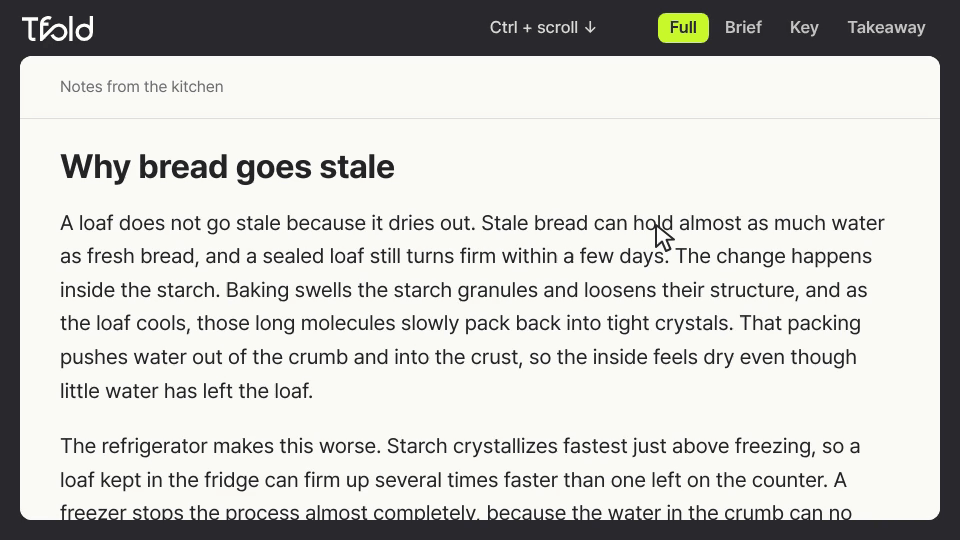
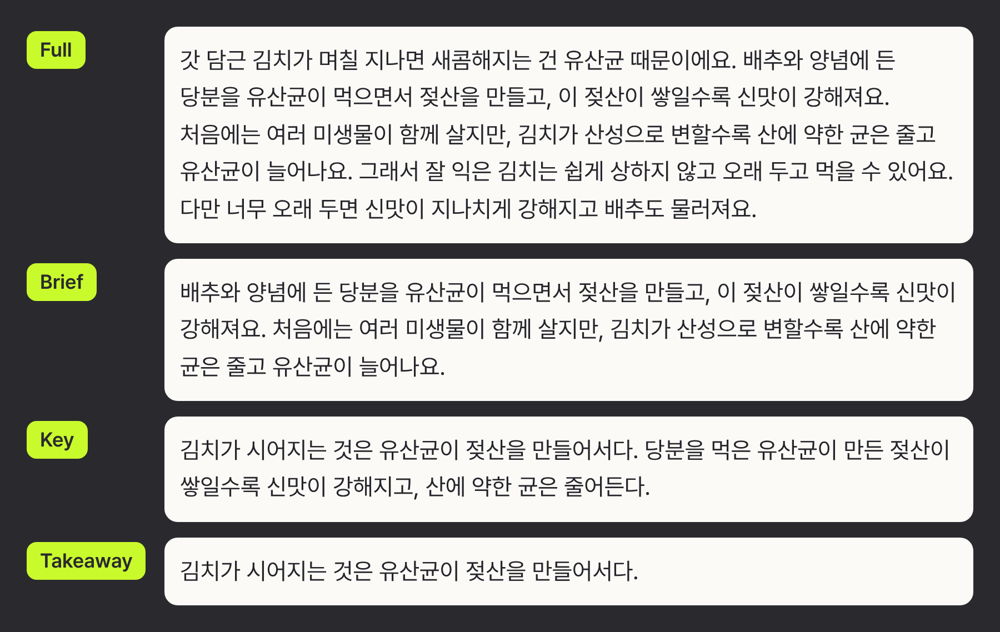
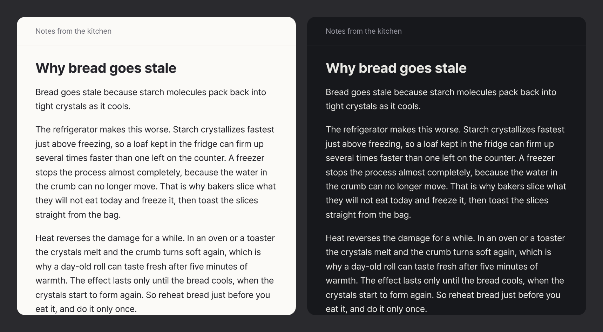
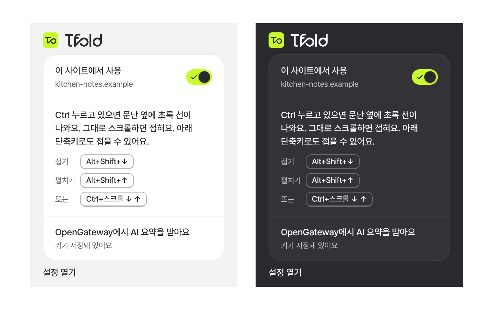

<p align="center">
  <picture>
    <source media="(prefers-color-scheme: dark)" srcset="assets/brand/tfold-wordmark-white.svg">
    
  </picture>
</p>

<p align="center"><b>읽던 문단을, 그 자리에서 짧게.</b></p>

<p align="center"><a href="README.md">English</a> | <b>한국어</b></p>

<p align="center">
  <a href="#빠른-시작">빠른 시작</a> |
  <a href="#접는-방법">접는 방법</a> |
  <a href="#문단이-접히는-방식">문단이 접히는 방식</a> |
  <a href="docs/media/tfold-product.mp4">제품 영상</a> |
  <a href="CONTRIBUTING.md">기여 안내</a> |
  <a href="SECURITY.md">보안</a> |
  <a href="LICENSE">AGPL-3.0</a>
</p>

<p align="center">
  
</p>

tfold는 읽고 있는 페이지에서 포인터 아래의 문단을 그 자리에서 줄여 주는 크롬 확장 프로그램이에요. 문단은 Full, Brief, Key, Takeaway 순서로 짧아졌다가 다시 길어지고, 문단마다 자기 단계를 기억해요. 따로 설치할 앱은 없고, AI 요약은 내 API 키로 받아요.

**tfold는 아직 출시 전이에요.** 크롬 웹 스토어에는 아직 없어요. 지금 써 보려면 [최신 빌드를 받거나](https://github.com/hoddukzoa12/tfold/releases/latest/download/tfold-open.zip) 소스에서 빌드한 뒤 직접 불러오세요. 이렇게 불러온 사본은 스스로 업데이트되지 않아요.

## 빠른 시작

크롬이나 크로미움이 필요해요. 계정과 키는 없어도 돼요.

빌드를 건너뛰려면 [`tfold-open.zip`](https://github.com/hoddukzoa12/tfold/releases/latest/download/tfold-open.zip)을 받아 지우지 않을 폴더에 푸세요. 크롬이 그 폴더에서 확장 프로그램을 읽어요.

직접 빌드하려면 Node 22 이상이 필요해요.

```sh
git clone https://github.com/hoddukzoa12/tfold.git
cd tfold
npm ci
npm run build
```

1. `chrome://extensions`를 열고 **개발자 모드**를 켜요.
2. **압축해제된 확장 프로그램을 로드합니다**를 누르고 압축을 푼 폴더를 골라요. 직접 빌드했다면 `dist` 폴더를 골라요.
3. 아무 글이나 열고 문단에 포인터를 올린 뒤, Ctrl 키(맥에서는 Cmd 키)를 누른 채 아래로 스크롤해요. 문단이 네트워크 요청 없이 그 문단의 글로 만든 빠른 요약으로 바로 접혀요. 위로 스크롤하면 다시 펼쳐져요.
4. AI 요약을 받으려면 툴바의 tfold 아이콘을 누르고 **설정 열기**를 눌러요. **AI 요약**에서 **OpenGateway에서 키 받기**로 키를 받아 **OpenGateway API 키**에 붙여 넣고 **키 저장**을 눌러요. 저장하기 전에 tfold가 그 키를 OpenGateway에 보내 확인해요. [OpenGateway](https://opengateway.ai) 대신 [OpenRouter](https://openrouter.ai)를 쓰려면 먼저 **고급**에서 **대신 OpenRouter 쓰기**를 눌러요.

설정 화면이 영어로 나오면 **언어 / Language**에서 **한국어**를 고르세요.

다시 빌드한 뒤에는 `chrome://extensions`의 tfold 카드에서 새로고침을 눌러요. 크롬을 다시 시작하기만 하면 이전 서비스 워커가 그대로 남아요.

이 빌드는 오픈 에디션이에요. 크롬 웹 스토어용 빌드는 `npm run build:store`이고, 에디션의 차이는 [CONTRIBUTING.md](CONTRIBUTING.md)에 있어요.

## 접는 방법

| 하고 싶은 일 | Windows, Linux | Mac |
| --- | --- | --- |
| 한 단계 접기 | Ctrl 키를 누른 채 아래로 스크롤, 또는 Alt+Shift+↓ | Cmd(⌘) 키를 누른 채 아래로 스크롤, 또는 ⌥⇧↓ |
| 한 단계 펼치기 | Ctrl 키를 누른 채 위로 스크롤, 또는 Alt+Shift+↑ | Cmd(⌘) 키를 누른 채 위로 스크롤, 또는 ⌥⇧↑ |

키를 누르면 초록 선이 접을 문단을 표시하고, 그 상태로 스크롤하면 접혀요. 맥에서는 Cmd 키를 누른 채 두 손가락으로 스크롤해요. 단축키도 같아요. 앞의 두 키를 누르고 있다가 화살표를 눌러요. Cmd+↓와 Ctrl+↓는 브라우저가 그대로 써요.

- **초록 선.** 단축키의 두 키를 누르면 바로 나타나요. 키 하나만 누르면 약 150 ms 뒤에 나타나고, 다른 키를 누르거나 클릭하거나 키를 떼면 바로 사라져요. 그래서 Cmd+C를 누를 때는 보이지 않아요. 제목, 빈 곳, 그림 위에서는 그 단에서 가장 가까운 문단을 표시해요. 선이 보이면 휠이나 화살표는 선이 표시한 문단을 접어요.
- **여러 문단.** 키를 누른 채 포인터를 옮겨요. 아래로 옮기면 선이 늘어나고, 되돌리면 줄어들고, 시작한 곳보다 위로 옮기면 위쪽을 골라요. 문단 사이의 제목과 그림은 건너뛰고, 사이드바나 다른 영역은 포함하지 않아요. 다른 요소에 가려졌거나 다른 층에 있는 문단도 마찬가지예요. 그래서 대화상자, 서랍, 고정 막대에서 시작한 묶음은 그 안에 머물고, 페이지에서 시작한 묶음은 그 안으로 들어가지 않아요. 페이지 위에 고정된 막대 밑으로 스크롤되어 들어갔을 뿐인 문단은 묶음에 남아요. 접으면 묶음 전체가 시작한 문단의 다음 단계로 함께 움직이고, 묶음은 키를 뗄 때까지 유지돼요. 한 묶음은 최대 20문단이고, 그보다 많으면 선이 멈추고 그 사실을 알려 줘요.
- **스크롤 키.** 설정의 **접는 방법**에서 맥의 Cmd(맥 기본값), Ctrl(맥에서는 Control, 맥 외 기본값), Alt(맥에서는 Option) 중에서 고르거나 끌 수 있어요. 이미 고른 키는 그대로 유지돼요. 이 키를 누르고 있어도 편집기, 캔버스, 지도, 프레임 위에서는 선이 나타나지 않고, Ctrl 키일 때는 그림 위에서도 나타나지 않아요. 그런 곳에서 휠은 페이지와 브라우저가 그대로 써요. 선이 나타나기 전에 돌린 휠은 그 아래 문단만 접고, 그런 문단이 없으면 키를 뗄 때까지 브라우저가 써요. 그래서 Ctrl 키와 빠른 스크롤로 하는 확대는 그대로 돼요. Cmd+C나 Cmd+클릭처럼 키의 뜻이 바뀐 뒤나, 페이지가 휠을 가져간 뒤에도 휠은 브라우저와 페이지에 남아요. tfold는 어디서든 브라우저의 확대 동작을 건드리지 않아요.
- **단축키.** 단축키는 선이 표시한 문단을 접어요. 포인터가 페이지에 없으면 키보드 포커스가 있는 문단을, 그것도 없으면 창 가운데에 가장 가까운 문단을 접어요. 대화상자가 열려 있으면 포인터만 봐요.
- **선이 나타나지 않을 때.** 입력란에 글을 쓰는 동안, 글자를 선택한 동안, 대화상자 뒤, tfold를 끈 사이트, 스토어 에디션에서 로그아웃한 동안, 화면에 문단이 없을 때, 프레임 안, 위아래 끝이 모두 보이지 않을 만큼 창을 가득 채운 문단 옆에서는 선이 나타나지 않아요. 스크롤되어 화면 밖으로 나간 묶음도 선이 나타나지 않아요. 마지막 두 경우에는 휠과 화살표가 아무것도 접지 않고 페이지에 남아요. 포커스가 프레임이나 주소창처럼 페이지 밖에 있으면 페이지는 키를 뗀 것을 알 수 없어요. 그래서 그때는 키를 누른 상태로 보인 마지막 포인터 이동이나 스크롤 뒤 0.5초 동안만 선이 남고, 다음 동작에서 다시 나타나요. 접어도 시작한 문단은 그 자리에 있어요. 다만 더 스크롤할 곳이 없는 페이지의 맨 위나 맨 아래는 예외예요.

설정에서 바로 접어 보려면 **여기서 접어 보기**로 가서 연습 문단에 포인터를 올리고 스크롤 키를 누른 채 스크롤해요. 네트워크 요청 없이 접혀요. 키가 없으면 실제 빠른 요약을 보여 주고, 2단계에서는 AI 요약 예시를 옆에 함께 보여 줘요. 키가 있으면 확장 프로그램에 들어 있는 AI 요약 예시를 보여 줘요.

## 문단이 접히는 방식

| 단계 | 읽게 되는 글 |
| --- | --- |
| Full | 페이지의 원래 문단이에요. |
| Brief | AI가 문단에서 고른 문장들이에요. 페이지의 마크업 그대로이고 링크도 동작해요. |
| Key | 문단의 요점과 한 문장을 더해 AI가 써 줘요. |
| Takeaway | 요점만 AI가 한 문장으로 써 줘요. |

tfold는 네트워크 요청 없이 페이지의 글로 만든 빠른 요약을 바로 보여 주고, AI의 글이 도착하면 바꿔 넣어요. 키가 없으면 빠른 요약이 그대로 남아요. AI가 걸리는 시간은 서비스에 따라 달라요.

<p align="center">
  
</p>

접힌 글은 페이지의 색과 글꼴을 따라가고, 페이지의 어두운 테마도 따라가요.

<p align="center">
  
</p>

툴바 창에서는 지금 사이트에서 tfold를 켜거나 꺼요. 어느 서비스가 문단을 접는지도 보여 주고, 키가 없으면 **키 넣기** 버튼을 보여 줘요. 웹 페이지에서 처음 접기 전에는 단축키와 스크롤 키가 그 줄 위에 보이고, 접은 뒤에는 그 줄 아래로 옮겨 가요.

<p align="center">
  
</p>

설정에는 화면 언어를 고르는 곳도 있고, 다른 언어로 된 문단을 Key 단계부터 내가 읽는 언어로 접는 스위치도 있어요. 이 스위치는 기본으로 꺼져 있고 저장된 키가 있어야 해요.

## tfold가 보내는 것

키를 저장하지 않으면 페이지 글을 보내지 않아요. 키를 저장했다면 아직 AI 요약이 없는 문단을 접을 때, 그 문단과 같은 구역의 이웃 문단 일부, 페이지 제목과 제목들을 내 키와 함께 내가 고른 서비스로 보내요. 묶어서 접은 문단들도 이렇게 나뉘어 가요. 문단을 표시하는 것만으로는 아무것도 보내지 않고, 페이지에서 처음 접기 전에는 페이지 글이 나가지 않아요. 번역 스위치를 켜면 번역이 필요한 다음 문단들을 접기 전에 보낼 수 있어요. 키를 저장할 때는 동작을 확인하려고 그 키만 해당 서비스로 보내요. 자세한 내용과 문제를 알리는 방법은 [SECURITY.md](SECURITY.md)에 있어요.

## 빌드와 테스트

`npm ci`와 `npx playwright install --with-deps chromium`으로 한 번 설치한 뒤 실행해요.

```sh
npm run lint && npm run typecheck && npm test
npm run e2e -- lanes/p1
npm run perf:boot
```

모든 스크립트와 레인, 실제 키가 필요한 레인은 [CONTRIBUTING.md](CONTRIBUTING.md)에 있어요.

## 이 페이지의 이미지와 영상

히어로 GIF, [제품 영상](docs/media/tfold-product.mp4), [소셜 미리보기](docs/media/tfold-social.png), 스틸 이미지는 실제 빌드로 이 저장소를 위해 쓴 페이지를 접어서 만들었어요. Key와 Takeaway의 글은 편집하지 않은 AI 출력이고, [`model-lines.json`](docs/media/src/model-lines.json)에 기록되어 있어요. 어두운 띠와 화살표 포인터는 편집에서 더했고, 촬영할 때 AI의 답을 미리 받아 두어서 GIF에는 기다리는 시간이 없어요. 다시 만드는 방법은 [`docs/media/src/README.md`](docs/media/src/README.md)에 있어요.

## 라이선스

tfold의 라이선스는 GNU Affero General Public License v3.0 only(AGPL-3.0-only)예요. `LICENSE`를 보세요. 이 번역은 안내용이고, 법적 내용은 영어 원문이 기준이에요.

TextFold에서 가져온 파일은 Apache License 2.0(`LICENSES/Apache-2.0.txt`)으로도 쓸 수 있고, `NOTICE`에 그 파일 목록과 TextFold의 저작자 표시가 있어요. 수정한 tfold를 네트워크 서비스로 운영하면, AGPL에 따라 그 서비스의 사용자에게 소스를 제공해야 해요.

AGPL은 코드에 적용돼요. tfold 이름이나 로고의 사용을 허락하지는 않으므로, 포크는 자기 이름과 로고를 써야 해요.
