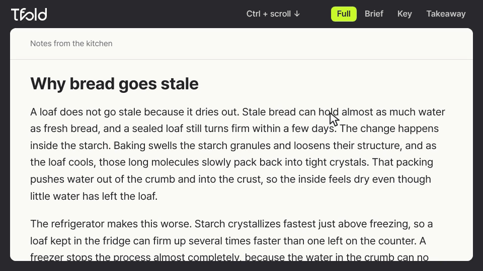
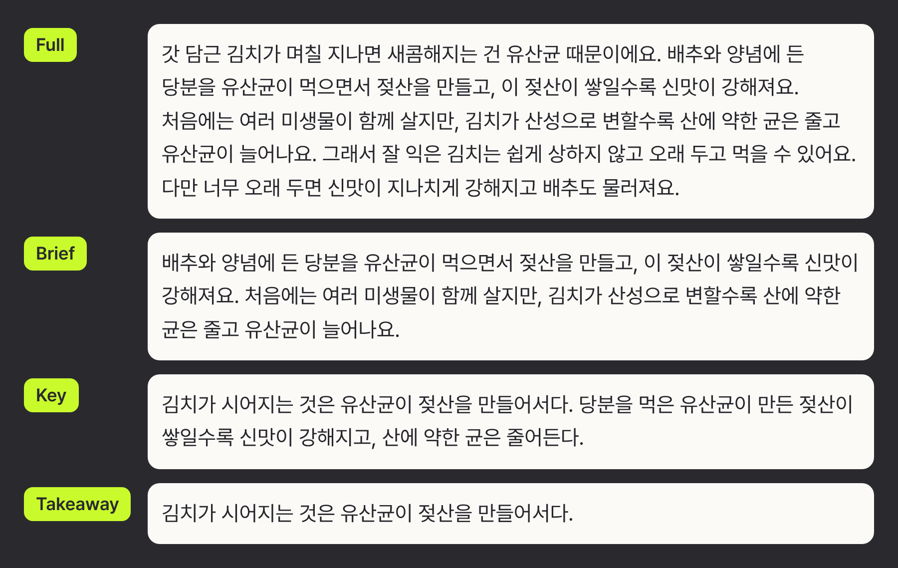
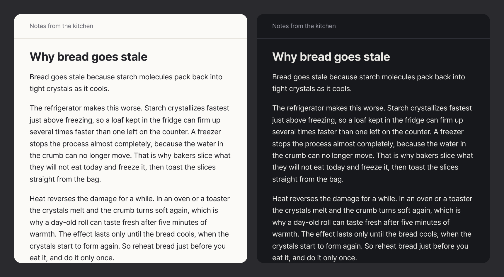
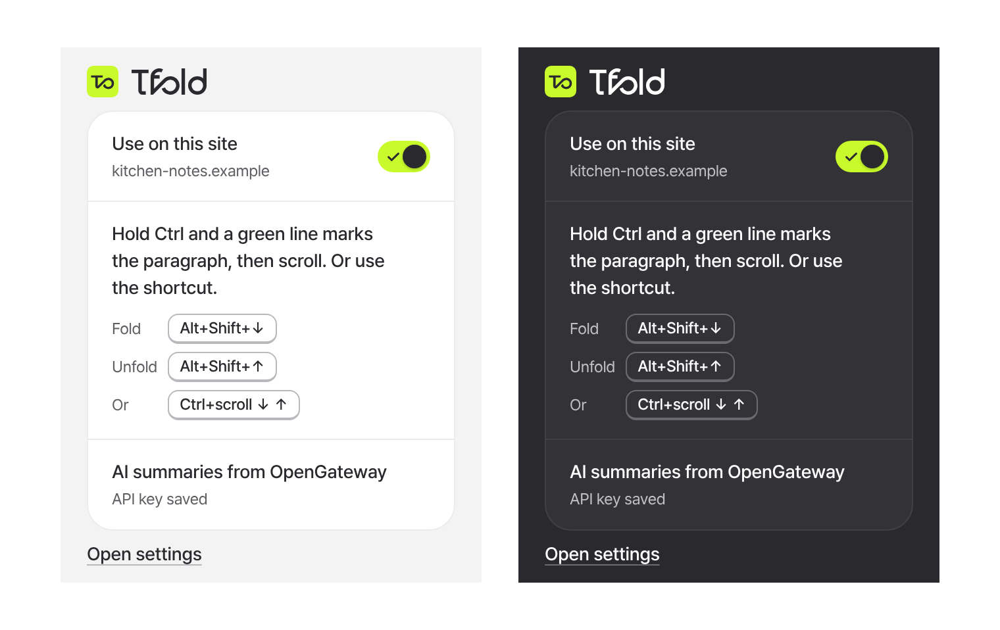

<p align="center">
  <picture>
    <source media="(prefers-color-scheme: dark)" srcset="assets/brand/tfold-wordmark-white.svg">
    
  </picture>
</p>

<p align="center"><b>Shorten the paragraph you are reading, right where it is.</b></p>

<p align="center"><b>English</b> | <a href="README.ko.md">한국어</a></p>

<p align="center">
  <a href="#quick-start">Quick start</a> |
  <a href="#ways-to-fold">Ways to fold</a> |
  <a href="#how-a-paragraph-folds">How a paragraph folds</a> |
  <a href="docs/media/tfold-product.mp4">Product video</a> |
  <a href="CHANGELOG.md">Changelog</a> |
  <a href="CONTRIBUTING.md">Contributing</a> |
  <a href="SECURITY.md">Security</a> |
  <a href="LICENSE">AGPL-3.0</a>
</p>

<p align="center">
  
</p>

tfold is a Chrome extension that shortens the paragraph under the pointer, in place, on the page you are reading. Each paragraph steps through Full, Brief, Key and Takeaway, and back, and keeps its own level. tfold needs no local app, and the model text comes from your own API key.

**tfold is pre-release.** It is not on the Chrome Web Store yet. To try it today, [download the latest build](https://github.com/hoddukzoa12/tfold/releases/latest/download/tfold-open.zip) or build it from source, then load it unpacked. A copy loaded this way does not update itself.

## Quick start

You need Chrome or Chromium. You need no account and no key.

To skip the build, download [`tfold-open.zip`](https://github.com/hoddukzoa12/tfold/releases/latest/download/tfold-open.zip) and unzip it into a folder you keep, because Chrome reads the extension from that folder.

To build it instead, you need Node 22 or newer:

```sh
git clone https://github.com/hoddukzoa12/tfold.git
cd tfold
npm ci
npm run build
```

1. Open `chrome://extensions` and turn on **Developer mode**.
2. Click **Load unpacked** and select the unzipped folder, or the `dist` directory if you built it.
3. Open any article, point at a paragraph, hold Ctrl (Cmd on a Mac), and scroll down. The paragraph folds at once to a quick summary made from its own text, with no network request. Scroll up to unfold it.
4. Optional: to get model text, click the tfold icon in the toolbar, then click **Open settings**. Under **AI summaries**, click **Get an OpenGateway key**, paste the key into **OpenGateway API key**, and click **Save key**. tfold sends the key to OpenGateway to check it before it saves the key. To use [OpenRouter](https://openrouter.ai) instead of [OpenGateway](https://opengateway.ai), first open **Advanced** and click **Use OpenRouter instead**.

After you rebuild, click **Reload** on the tfold card in `chrome://extensions`. A Chrome restart alone keeps the old service worker.

This build is the open edition. The store edition, `npm run build:store`, waits for sign-in, and [CONTRIBUTING.md](CONTRIBUTING.md) explains the editions.

## Ways to fold

| To do this | Windows and Linux | Mac |
| --- | --- | --- |
| Fold one level | Hold Ctrl and scroll down, or press Alt+Shift+↓ | Hold Cmd (⌘) and scroll down, or press ⌥⇧↓ |
| Unfold one level | Hold Ctrl and scroll up, or press Alt+Shift+↑ | Hold Cmd (⌘) and scroll up, or press ⌥⇧↑ |

Hold the key, the green line shows the target, then scroll. On a Mac, that is Cmd and a two-finger scroll. The shortcuts work the same way: hold their first keys, then press the arrow. Cmd+↓ and Ctrl+↓ stay with the browser.

- **The line.** The shortcut's modifier keys show it at once. One key held alone shows it after about 150 ms, and another key, a click or letting go takes it away at once, so Cmd+C shows nothing. Over a heading, a gap or a picture it marks the nearest paragraph in that column. If the line shows, the wheel or the arrow folds what it marks.
- **Several paragraphs.** Keep holding and move the pointer. Moving down extends the line, moving back shrinks it, and moving above where you started selects upward. Headings and pictures between paragraphs are skipped, and a sidebar or another pane does not join. Nor does a paragraph behind something else or in another layer, so a run started in a dialog, a drawer or a fixed bar stays in it, and a run on the page stays out of them. A paragraph that has only scrolled under a bar fixed over the page stays in the run. A fold moves the whole run to one level, the level after the paragraph you started on, and the run stays until you let go. A run holds up to 20 paragraphs, and past that the line stops and says so.
- **Short lines.** A paragraph or list item of two words or more counts when it sits in the same column as a long paragraph, so a run does not break around it. A short item that is mostly links, a formula, text on a picture or a video, and a line right beside a picture do not count. A line under 12 words has nothing to shorten, so its words stay the same at each level, and it asks the provider only when it needs translating.
- **Scroll key.** Under **Ways to fold** in settings, you can set the key to Cmd on a Mac, which is the default there, or Ctrl (Control on a Mac), which is the default elsewhere, or Alt (Option on a Mac), or turn it off. A key you already chose stays. With that key held, no line shows over an editor, a canvas, a map or a frame, or over a picture with Ctrl, and the wheel stays with the page and the browser there. A wheel that turns before the line shows folds only a paragraph under it, and otherwise stays with the browser until you let go, so Ctrl and a quick scroll still zooms. The wheel also stays there after that key went on to mean something else, as in Cmd+C or Cmd+click, or after a page took the wheel for itself. tfold leaves browser zoom gestures alone everywhere.
- **Shortcuts.** A shortcut folds what the line marks. With no pointer on the page, that is the paragraph that has keyboard focus, then the paragraph nearest the middle of the window. While a dialog is open, only the pointer counts.
- **When there is no line.** The line does not show while you type in a field, while text is selected, behind a dialog, on a site turned off, when signed out of the store edition, with no paragraph on screen, inside a frame, or beside a paragraph that fills the window edge to edge with neither its top nor its bottom showing. A run scrolled out of sight shows no line either. In those last two cases the wheel and the arrow fold nothing and stay with the page. With focus outside the page, such as in a frame or the address bar, the page cannot see a key come up, so there the line lasts half a second past the last pointer move or scroll that showed the keys held, and it comes back on the next one. A fold keeps the paragraph you started on still, except at the very top or bottom of a page, where there is nothing left to scroll.

To try a fold without leaving settings, go to **Try it here**, point at the test paragraph, and hold the scroll key and scroll. It folds with no network request. With no key saved, it shows the real quick summary, and at level 2 it puts an example AI summary next to it. With a key saved, it shows the example AI levels, which ship with the extension.

## How a paragraph folds

| Level | What you read |
| --- | --- |
| Full | The page's own paragraph. |
| Brief | Sentences that the model picks from the paragraph, in the page's own markup, with its links still working. |
| Key | The point of the paragraph and one more sentence, written by the model. |
| Takeaway | The point alone, in one sentence from the model. |

tfold shows a quick summary from the page's own text at once, with no network request, and swaps in the model's text when it arrives. Without a key you keep the quick summary. How long the model takes depends on your provider.

<p align="center">
  
</p>

A fold takes its colors and type from the page, including a page's own dark theme.

<p align="center">
  
</p>

The toolbar popup turns tfold on or off for the site you are on. It also shows which provider folds your paragraphs, or an **Add a key** button when no key is saved. Before your first fold on a web page, the popup shows the shortcuts and the scroll key above that row. After that fold, they move below that row.

<p align="center">
  
</p>

Settings also has a language setting for the interface, and a switch that folds paragraphs in another language into your reading language from Key on. The switch is on by default and needs a saved key. A paragraph already in your reading language folds with no translation.

## What tfold sends

With no key saved, tfold sends no page text. With a key saved, when you fold a paragraph that has no model text yet, tfold sends that paragraph and some of its neighbors in the same section, the page title and the page's headings to the provider you chose, with your key. A run of paragraphs folded together goes in groups like this. Marking paragraphs sends nothing, and no page text goes out before your first fold on a page. With the translation switch on, which is the default, a fold can also send the next paragraphs that need translating, before you fold them. When you save a key, tfold sends only that key to its provider, to check that it works. [SECURITY.md](SECURITY.md) has the details and says how to report a problem.

## Build and test

Install once with `npm ci` and `npx playwright install --with-deps chromium`, then:

```sh
npm run lint && npm run typecheck && npm test
npm run e2e -- lanes/p1
npm run perf:boot
```

[CONTRIBUTING.md](CONTRIBUTING.md) lists every script and lane, and says which lanes need a live key.

## About the media on this page

The hero GIF, the [product video](docs/media/tfold-product.mp4), the [social preview](docs/media/tfold-social.png) and the stills come from real builds folding a page written for this repository. The Key and Takeaway text is unedited model output, recorded in [`model-lines.json`](docs/media/src/model-lines.json). The dark band and the arrow pointer are added in editing, and the capture has the model's answer before the fold starts, so the GIF shows no wait. To rebuild them, follow [`docs/media/src/README.md`](docs/media/src/README.md).

## License

tfold is licensed under the GNU Affero General Public License v3.0 only (AGPL-3.0-only). See `LICENSE`.

Files derived from TextFold also stay available under the Apache License 2.0 (`LICENSES/Apache-2.0.txt`), and `NOTICE` lists them with TextFold's attribution. If you run a modified tfold as a network service, the AGPL requires you to offer its source to that service's users.

The AGPL covers the code. It does not license the tfold name or logo, so a fork must use its own.
